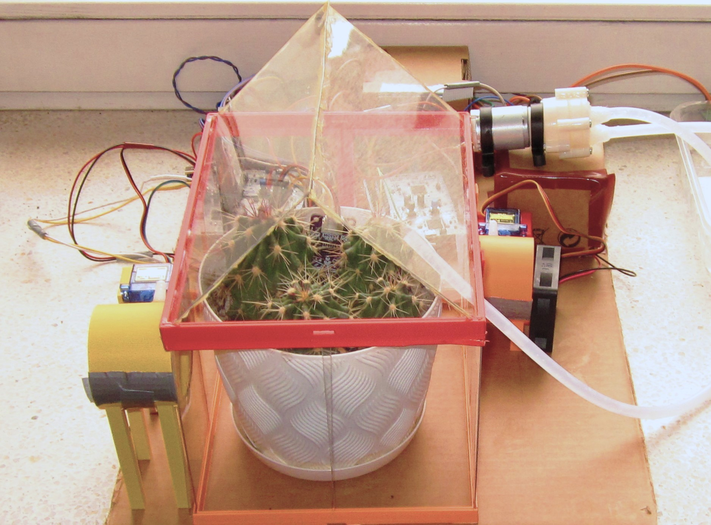
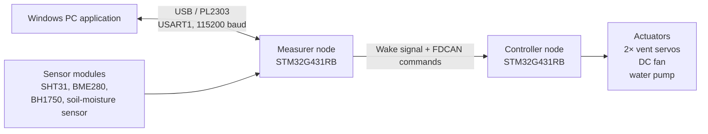
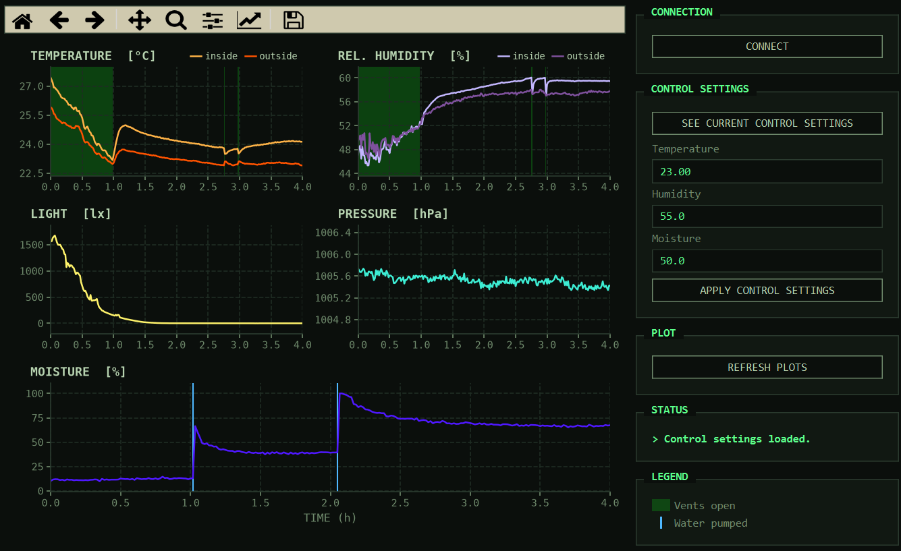

# STM32 Automated Greenhouse

Firmware and desktop software for a two-node STM32 greenhouse prototype system that can monitor environment conditions and autonomously control ventilation and plant watering.

The system samples the temperature and humidity inside and outside the greenhouse enclosure, compares them with user-configured targets, and commands servo-driven vents, a fan, and a water pump. The user can connect to the device using USB and use the desktop application to configure control parameters and see the plotted measurement history.



## Highlights

- Two STM32G431RB Nucleo nodes communicate using FDCAN:
  - a **measurer** node acquires sensor data, issues control commands, stores history, and communicates with the PC;
  - a **controller** node operates the vent servos, fan, and pump.
- Samples temperature, relative humidity, pressure, light level, and soil moisture.
- Provides configurable temperature, humidity, and soil moisture targets.
- Stores up to 576 measurements at 60-second intervals, with the measurement timing configurable in the firmware.
- Includes a Python/PyQt desktop application for changing control targets and plotting measurement data and actuator events.
- Combines STM32 HAL/CubeMX configuration with handwritten bare-metal drivers for GPIO, I²C, UART, and RTC scheduling.
- Includes a KiCad schematic, a bill of materials, a 3D-printable enclosure and vent parts.

## System overview

This project was built as a personal embedded-systems portfolio project. The focus was firmware, system architecture, and integration. It uses off-the-shelf sensor modules and STM32 Nucleo development boards.



The PC application retrieves and plots measurement reconds, while also marking events like vent movement and water being pumped into the enclosure. It can also be used to read and write the control settings for the temperature, humidity and soil moisture.



## Hardware

### Main components

The hardware setup consists of two NUCLEO-G431RB boards, which serve as the targets for the measurer and controller firmware. Environmental conditions are monitored using an SHT31 module for temperature and relative humidity inside the enclosure, a BME280 module for temperature, relative humidity, and pressure outside the enclosure, with a BH1750 module used for measuring the amount of light near the enclosure. Soil moisture is measured using an analog capacitive sensor.

The NUCLEO nodes communicate using two SN65HVD230 CAN transceiver modules, while the measurer node also uses a PL2303 USB-to-UART module, providing a serial connection between the hardware and the PC application.

The greenhouse ventilation system is operated by two SG90 servos, which control the opening and closing of the ventilation tunnels. A DC fan provides forced ventilation when the vents are open, while a water pump is used for plant irrigation. The fan and pump are controlled by the MCU using a logic-level MOSFET, and powered by a 12V power supply. An XL4015 buck converter is used to provide 5V to the servos and NUCLEO boards.

The exact wiring with both power connections and signal routing is documented in the [KiCad schematic](kicad_schematics/greenhouse_schematic.pdf), while a bill of materials is included in the [parts directory](parts/bom.csv).

### Mechanical design

The enclosure and vent mechanism were designed for this project. Printable parts are available in [`3d_models/`](3d_models/), including the frame, vent tunnels, paddles, and servo mounts.

Additional early visualization renders and prototype photos are available in [`images/`](images/).

## Firmware architecture

Two independently flashed STM32CubeIDE projects can be found in [`src/firmware/`](src/firmware/).

### Measurer node

The measurer node is responsible for waking periodically through the RTC wake-up timer and then acquiring and storing data from the SHT31, BME280, BH1750, and analog soil moisture sensor. It then evaluates the control logic used for vents and pump, and sends control commands to the controller node over FDCAN. At all times, it also serves configuration and history requests from the PC application over UART.

The time period between measures can be configured in the firmware, with a default of 60 seconds. The node retains up to 576 newest measurement records in memory.

### Controller node

The controller node receives FDCAN commands and performs actuator actions, like moving the vent paddles using PWM servo commands, pumping water for a set amount of time, enabling or disabling the DC fan.

### Control behaviour

The measured inside temperature and relative humidity are compared with user targets and configured margins. 

Based on the conditions inside and outside, the firmware decides to enable or disable the ventilation, by for example allowing colder air from outside to circulate inside the enclosure when the inside temperature is too high. In a similar manner, the firmware tries to balance the relative humidity by using the humidity ratios inside and outside the enclosure.

The plant is watered when the soil sensor moisture level crosses the configured threshold, with a minimum one-hour wait between watering events to prevent overwatering the plant and letting the pumped water spread thorough the soil.

The default settings compiled into the firmware are:

| Parameter | Default |
|---|---:|
| Temperature | 23 °C |
| Relative humidity | 55 % |
| Soil moisture ADC threshold | 50 % = 2 V |
| Measurement interval | 60 s |
| Minimum watering interval | 60 min |

The desktop application can replace the first three target values at runtime, while the other two need to be changed in the firmware and recompiled.

## Firmware implementation

### Bare-metal drivers

The reusable firmware in [`src/firmware/libs/`](src/firmware/libs/) contains handwritten drivers and services that access STM32 peripheral registers directly.

| Module | Implementation |
|---|---|
| `GPIO_manager` | Enables GPIO clocks and configures pin mode, pull configuration, speed, alternate function, and allows setting the pin output. |
| `I2C_driver` | Interrupt-driven I²C read/write transactions for all three I²C peripherals, with reset on errors. |
| `UART_driver` | USART1 driver using hardware FIFOs, interrupt-driven TX/RX, IDLE-line frame detection, circular receive buffering, error recovery, and wake-up from STOP mode. |
| `periodic_service_manager` | Configures the LSE-driven RTC wake-up timer and its interrupt. |
| Sensor drivers | Device-specific initialization, command sequencing and data decoding. |

Sensor acquisition is coordinated as a small non-blocking state machine. Individual sensors have bounded retries and wait times, and failed acquisitions are represented by flags in the recorded data rather than silently discarded.

### STM32 HAL and CubeMX

CubeMX-generated project code configures clocks, startup code, FDCAN, ADC, PWM, GPIO, and interrupt vectors. HAL is also used in application code to handle:

- FDCAN startup, notifications, queueing, completion callbacks, aborts, and error callbacks.
- ADC conversion interrupt handling.
- TIM PWM start/stop and compare-register updates for servos.
- System tick timing and STOP1 entry/exit support.

## Desktop application

The desktop application can be found in [`src/pc_app/`](src/pc_app/). It is written in Python using PyQt6, Matplotlib, and pyserial, and was run and validated on Windows with Python 3.14.

It detects the USB-UART adapter nad connects to it with the appropriate settings. Using the application, the user can see the plotted measurement history, along with the controller events like pumping water or enabling/disabling the ventilation. It can also be used to retrieve the control targets used by the system and change them during runtime.

## Repository structure

```text
.
├── 3d_models/              Printable enclosure, vent, frame, and servo-mount STL files
├── images/                 Prototype photos, renders, and app screenshot
├── kicad_schematics/       KiCad project and exported schematic PDF
├── parts/                  Bill of materials in csv format
└── src/
    ├── firmware/
    │   ├── controller/     CubeMX / STM32CubeIDE controller target
    │   ├── measurer/       CubeMX / STM32CubeIDE measurer target
    │   └── libs/           Handwritten firmware modules and reusable drivers
    └── pc_app/             Python/PyQt monitoring and configuration application
```

## Validation

Validation was performed on the assembled hardware through end-to-end functional testing.

The working prototype was used to verify that it can:

- acquire sensor readings,
- accept updated control settings through the PC application,
- retrieve and plot recorded measurements,
- command vent movement and fan operation,
- command the water pump,
- exchange commands between STM32 nodes.

The prototype photographs and application screenshot in [`images/`](images/) were captured from this working setup.

## License

This repository contains components under different licensing terms.

The MIT license in:

- [`src/firmware/libs/LICENSE.txt`](src/firmware/libs/LICENSE.txt)
- [`src/pc_app/LICENSE.txt`](src/pc_app/LICENSE.txt)

applies only to those directories.

STM32 HAL, CMSIS, CubeMX-generated files, and other third-party components retain their own licences.